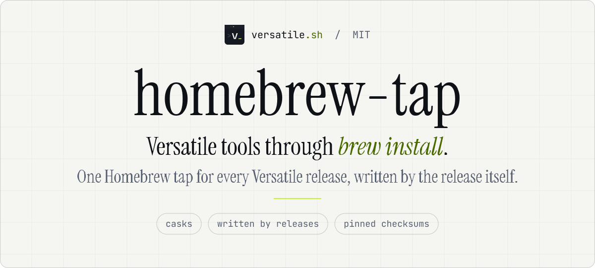
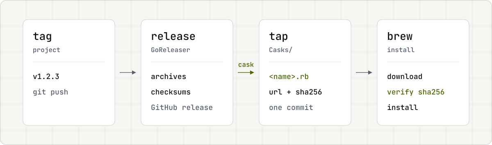

<p align="center">
  <picture>
    <source media="(prefers-color-scheme: dark)" srcset="docs/assets/banner-hero-dark.svg">
    
  </picture>
</p>

<p align="center">
  <a href="LICENSE"></a>
</p>

<p align="center">
  <b><a href="#quick-start">Quick start</a></b> &nbsp;·&nbsp;
  <b><a href="#usage">Casks</a></b> &nbsp;·&nbsp;
  <a href="#how-it-works">How it works</a> &nbsp;·&nbsp;
  <a href="#configuration">Publishing</a> &nbsp;·&nbsp;
  <a href="#development-and-checks">Development</a>
</p>

The Homebrew tap of Versatile: install Versatile command-line tools on macOS with `brew install`, from casks that each project's release writes here.

<a id="what-it-is"></a>

<picture>
  <source media="(prefers-color-scheme: dark)" srcset="docs/assets/section-what-it-is-dark.svg">
  
</picture>

A [Homebrew tap](https://docs.brew.sh/Taps) is a Git repository that Homebrew reads casks from. This one holds a cask per Versatile project that ships binaries, in `Casks/`.

| It does | It does not |
| --- | --- |
| Install a project's release archive with `brew install versatile-sh/tap/<name>` | Build anything: the archives come from the project's GitHub release |
| Pin each archive to its SHA-256 checksum, so Homebrew refuses a changed file | Hold hand-written casks: each one is written by its project's release |
| Upgrade with `brew upgrade` when a project tags a new version | Replace each project's own installer script or container image |

<a id="how-it-works"></a>

<picture>
  <source media="(prefers-color-scheme: dark)" srcset="docs/assets/section-how-it-works-dark.svg">
  
</picture>

<picture>
  <source media="(prefers-color-scheme: dark)" srcset="docs/assets/diagram-release-dark.svg">
  
</picture>

1. A project pushes a version tag, such as `v1.2.3`.
2. Its release workflow runs GoReleaser: it builds the archives and publishes the GitHub release.
3. GoReleaser commits `Casks/<name>.rb` to this tap, with the archive URLs and their SHA-256 checksums.
4. `brew install` reads the cask, downloads the archive for your machine, verifies the checksum and installs the binary.

<a id="quick-start"></a>

<picture>
  <source media="(prefers-color-scheme: dark)" srcset="docs/assets/section-quick-start-dark.svg">
  
</picture>

No cask is published yet: the first one arrives with the first release of a project that publishes here. Then:

```sh
brew tap versatile-sh/tap
brew install versatile-sh/tap/<name>
```

`brew tap` clones this repository once; `brew install` names the cask. `brew info versatile-sh/tap/<name>` shows the version before you install it.

<a id="usage"></a>

<picture>
  <source media="(prefers-color-scheme: dark)" srcset="docs/assets/section-usage-dark.svg">
  
</picture>

| Cask | Project | Installs |
| --- | --- | --- |
| none yet | | |

| Command | Does |
| --- | --- |
| `brew upgrade versatile-sh/tap/<name>` | Installs the newest released version |
| `brew uninstall versatile-sh/tap/<name>` | Removes it |
| `brew untap versatile-sh/tap` | Forgets this tap |

<a id="configuration"></a>

<picture>
  <source media="(prefers-color-scheme: dark)" srcset="docs/assets/section-configuration-dark.svg">
  
</picture>

A project publishes here from its own `.goreleaser.yaml`, with a `homebrew_casks` entry whose repository is `versatile-sh/homebrew-tap` and whose directory is `Casks`. The release workflow passes GoReleaser a token that can push to this repository, read from a CI secret; the token is never written in a file.

```yaml
homebrew_casks:
  - name: <name>
    ids: [<archive id>]
    directory: Casks
    homepage: https://github.com/versatile-sh/<project>
    description: <one line>
    repository:
      owner: versatile-sh
      name: homebrew-tap
      token: "{{ .Env.HOMEBREW_TAP_TOKEN }}"
```

A new cask also adds its row to [The casks](#usage) in the same release.

<a id="development-and-checks"></a>

<picture>
  <source media="(prefers-color-scheme: dark)" srcset="docs/assets/section-development-and-checks-dark.svg">
  
</picture>

A fresh clone runs `mise install` and `lefthook install` once. Then:

```sh
mise run check   # Semgrep with p/secrets and the shared rules, then the README lint
mise run images  # regenerate the README images in docs/assets
```

The pre-push hook runs `mise run check`. The README images are generated by `docs/assets/src/build-banners.mjs` from `docs/assets/src/readme.assets.json`; never edit an SVG by hand.

<a id="security-notes"></a>

<picture>
  <source media="(prefers-color-scheme: dark)" srcset="docs/assets/section-security-notes-dark.svg">
  
</picture>

Every cask pins the checksum of the archive it installs; a mismatch on install is a security problem, so report it rather than working around it. The token that writes casks lives only in each project's CI secrets. Report a vulnerability as described in [SECURITY.md](SECURITY.md), not in a public issue.

<a id="contributing"></a>

<picture>
  <source media="(prefers-color-scheme: dark)" srcset="docs/assets/section-contributing-dark.svg">
  
</picture>

A change to a cask is a change to its project's release configuration: open it there. Changes to this repository's own files arrive as a pull request; see [CONTRIBUTING.md](CONTRIBUTING.md).

<a id="license"></a>

<picture>
  <source media="(prefers-color-scheme: dark)" srcset="docs/assets/section-license-dark.svg">
  
</picture>

Copyright (c) 2026 Versatile (versatile.sh)

homebrew-tap is released under the [MIT License](LICENSE). Each cask installs software under its own project's licence.
